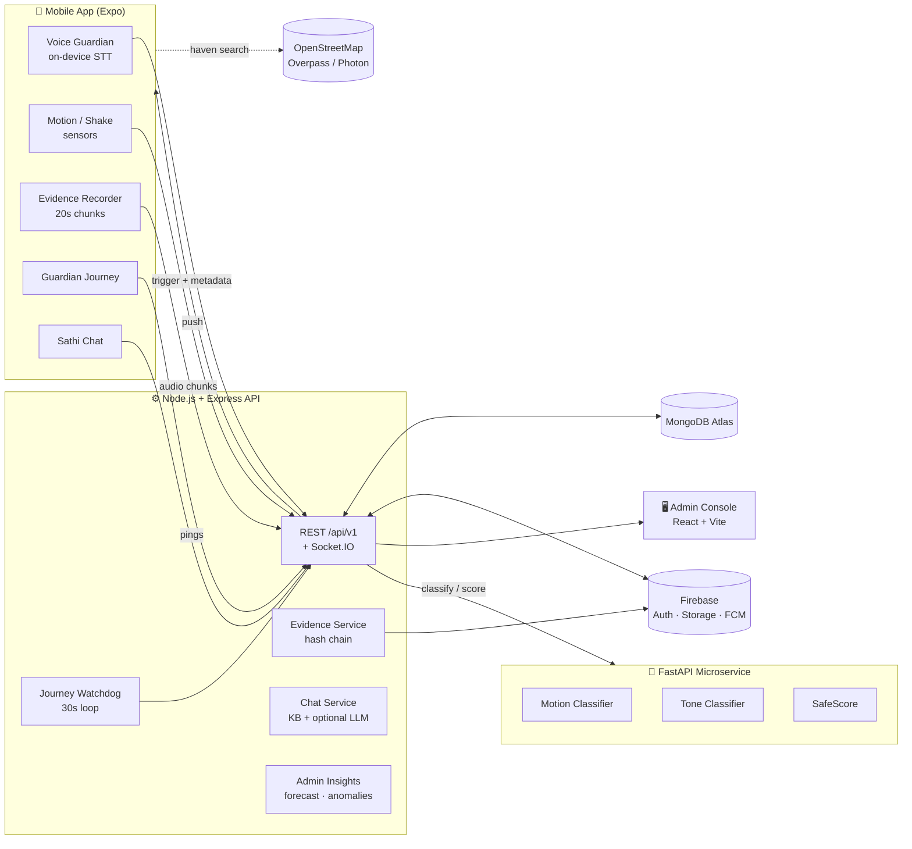
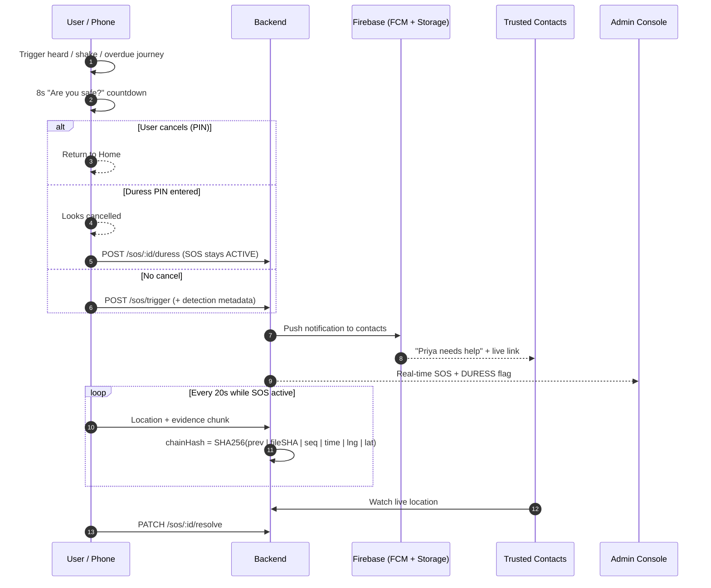
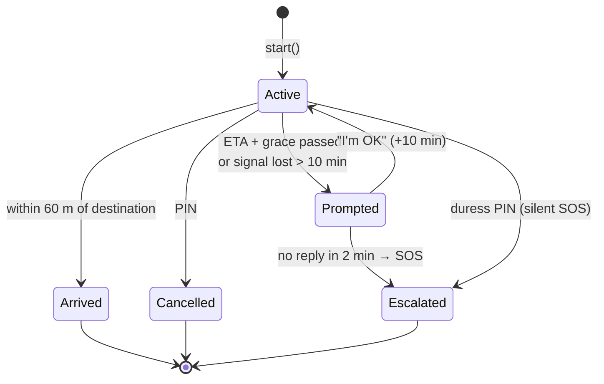
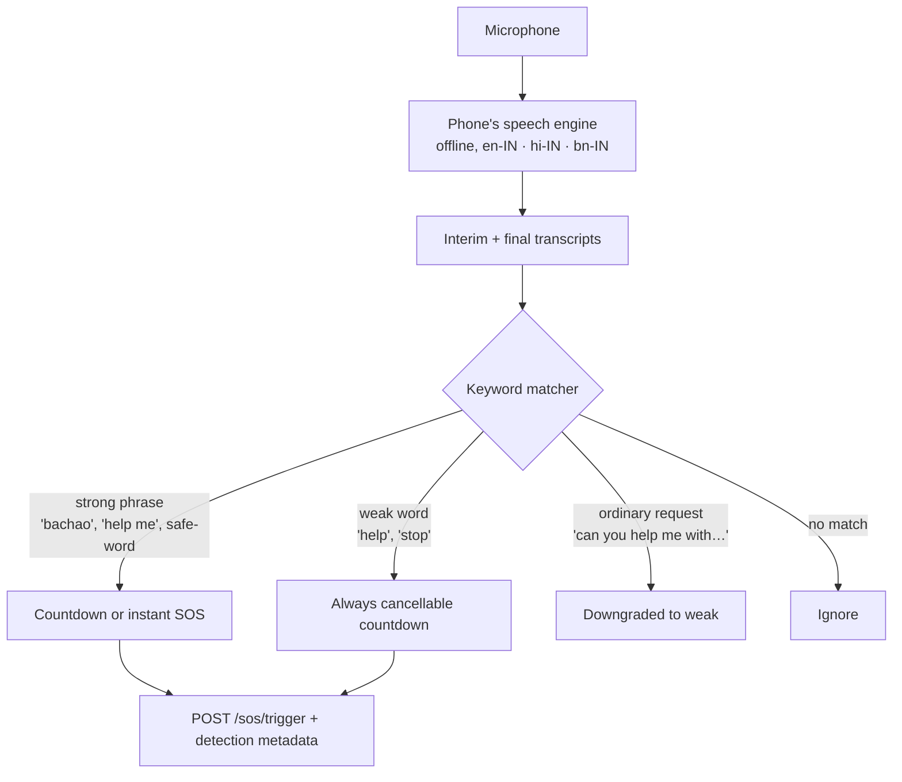
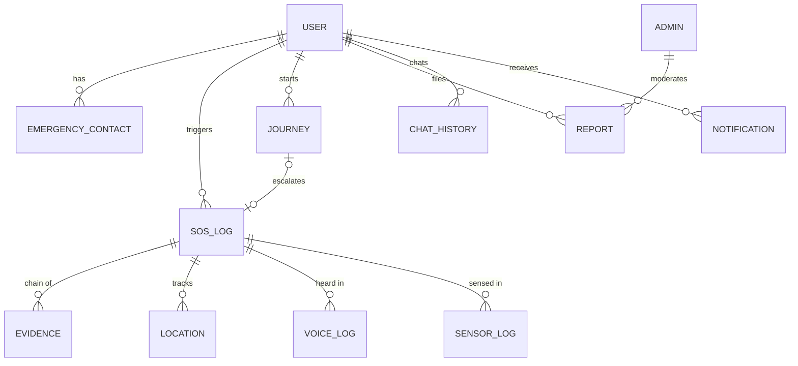

<div align="center">

# 🛡️ SafeSathi

### *Proactive safety, not just an SOS button.*

**An AI-powered women's safety ecosystem that listens, senses, and acts — even when the user can't.**

<br/>


<br/>

[**Live Admin Console**](https://safesathi-admin-dashboard.vercel.app) ·
[**Backend API**](https://safesathi-ai-backend.onrender.com/health) ·
[**AI Microservice**](https://safesathi-ai-microservice.onrender.com/health)

</div>

---

## 📌 Project Information

| | |
|---|---|
| **Project title** | SafeSathi — AI-Powered Proactive Women's Safety System |
| **Team** | 404 Error Not Found |
| **Developer** | Roni Seikh |
| **Institution** | Brainware University |
| **Programme** | B.Tech in Computer Science & Engineering — Final Year Project |
| **Academic year** | 2026 |
| **Repository** | [github.com/Roni-Seikh/SafeSathi-Ai](https://github.com/Roni-Seikh/SafeSathi-Ai) |

---

## 📑 Table of Contents

1. [Abstract](#1--abstract)
2. [Problem Statement & Motivation](#2--problem-statement--motivation)
3. [Objectives](#3--objectives)
4. [Key Features](#4--key-features)
5. [System Architecture](#5--system-architecture)
6. [Technology Stack](#6--technology-stack)
7. [Machine-Learning Models](#7--machine-learning-models)
8. [How the Voice Guardian Works](#8--how-the-voice-guardian-works)
9. [SafeScore Algorithm](#9--safescore-algorithm)
10. [Evidence Vault & Chain of Custody](#10--evidence-vault--chain-of-custody)
11. [Admin Command Center](#11--admin-command-center)
12. [Database Design](#12--database-design)
13. [REST API Overview](#13--rest-api-overview)
14. [Repository Structure](#14--repository-structure)
15. [Getting Started](#15--getting-started)
16. [Environment Variables](#16--environment-variables)
17. [Deployment](#17--deployment)
18. [Testing & Verification](#18--testing--verification)
19. [Security & Privacy](#19--security--privacy)
20. [Limitations & Honest Scope](#20--limitations--honest-scope)
21. [Future Scope](#21--future-scope)
22. [Datasets, References & Acknowledgements](#22--datasets-references--acknowledgements)
23. [Disclaimer](#23--disclaimer)

---

## 1. 📖 Abstract

Most women's-safety applications are **reactive**: the user must already be in trouble *and* be free enough to unlock the phone and press a button. In a real emergency — an abduction attempt, a physical struggle, a sudden fall — that assumption often fails.

**SafeSathi** (*"Sathi"* = companion in Hindi/Bengali) inverts this assumption. It continuously watches for danger signals — a **spoken distress phrase** in English, Hindi or Bengali, a **scream**, a **sudden fall**, an **overdue journey** — and acts on the user's behalf: it opens a cancellable countdown, shares live location with trusted contacts, records **tamper-evident audio evidence**, and alerts an administrator console in real time. It also helps users *avoid* danger through a live **SafeScore**, a **Guardian Journey** dead-man's-switch, a **Safe Haven** finder and a legally-grounded **AI assistant** (*Sathi*).

The system is a four-service monorepo — a React Native mobile app, a Node/TypeScript API, a Python ML microservice and a React admin console — with machine-learning models **trained on real public datasets** and evaluated on **held-out subjects**, not on the training distribution.

---

## 2. 🎯 Problem Statement & Motivation

| Gap in existing apps | What SafeSathi does instead |
|---|---|
| A button must be pressed under stress | Hands-free triggers: voice, shake, fall, overdue journey |
| A false alarm spams family & police | An 8-second **"Are you safe?"** cancel countdown for every auto-detection |
| An attacker can force the victim to cancel | **Duress PIN** — looks cancelled, keeps the SOS alive |
| Evidence is lost or can be disputed | Chunked audio, **SHA-256 hash-chained**, verifiable by admins and police |
| Apps need servers/network to even *hear* a trigger word | **On-device** speech recognition — works offline |
| Users don't know their legal options | **Sathi AI** with Indian-law knowledge (Zero FIR, BNS, POSH, helplines) |
| Admins only see a list of alerts | **Command Center**: forecasting, anomaly detection, hotspot clustering, insights |

---

## 3. 🧭 Objectives

1. Detect emergencies **proactively** from voice, motion and journey signals.
2. Keep false-alarm cost low through human-in-the-loop countdowns.
3. Preserve **admissible, tamper-evident evidence** automatically.
4. Provide authorities/admins with **actionable intelligence**, not just raw logs.
5. Train and evaluate ML models **rigorously on real data** with leakage-free splits.
6. Deliver a deployable, secure, well-documented full-stack system.

---

## 4. ✨ Key Features

### 📱 Mobile App (Expo / React Native)

<table>
<tr><td width="50%" valign="top">

**🎙️ Voice Guardian** *(on-device)*
- Offline speech recognition via the phone's own engine
- Multilingual trigger phrases — English, Hindi (Roman + देवनागरी), Bengali (Roman + বাংলা)
- Typo-tolerant fuzzy matching + context guard (*"can you help me with homework"* ≠ emergency)
- Personal **secret safe-word**
- **Voice Test** screen: live mic level, live transcript, diagnostic checklist
- **Pocket Mode** — screen on but black, keeps listening in a bag

**🆘 SOS Pipeline**
- Hold-to-send SOS button
- Cancellable 8-second countdown for auto-detections
- Panic-shake (3 hard shakes) trigger
- Live location streaming to contacts (REST + Socket.IO)
- Loud **siren** + full-screen **strobe** deterrent

**🔐 Duress PIN**
- Normal PIN ends the SOS
- Duress PIN *appears* to end it — but the SOS stays live and admins see a **DURESS** flag

</td><td width="50%" valign="top">

**🧭 Guardian Journey** *(dead-man's switch)*
- Walk / cab / transit modes, auto-ETA, vehicle number
- Server-side **watchdog** — works even if the phone dies
- "Are you OK?" prompt → no reply → **automatic SOS**
- Shareable trip details

**🎞️ Evidence Vault**
- Auto-records 20-second AAC chunks after an SOS
- Offline-safe upload queue (survives app restarts)
- In-app playback, integrity badge, police-ready incident summary

**🤖 Sathi AI Assistant**
- Retrieval-grounded answers on Indian law & safety
- Emergency phrases bypass the LLM and answer instantly
- Action buttons: SOS · call · fake call · safe haven · journey

**📞 Fake Call That Talks**
- Realistic incoming-call UI with scripted **text-to-speech** conversation (English/Hindi) to deter harassers

**📍 Safe Haven Finder** — nearest police, hospitals, 24×7 pharmacies & fuel stations (OpenStreetMap, offline cache)

**📊 Live SafeScore**, community alerts, incident reporting, safe-route scoring

</td></tr>
</table>

### 🖥️ Admin Console (React + Vite + Tailwind)

- **Command Center** — city risk index gauge, six animated KPIs, 7-day forecast, anomaly markers
- **AI Insights** — explainable, auto-generated findings; detector precision; hour-of-day profile
- **SOS Monitor** with **Evidence Vault drawer** (tamper verification + audio playback)
- Hotspot clustering, weekday×hour heatmap, report moderation, user management, CSV export
- Dark / light theme, `Ctrl/⌘ + K` command palette, live SOS badge

### 🧠 AI Microservice (FastAPI)

- Motion classifier (fall / running / normal) and scream-tone classifier — **real-data trained**
- SafeScore computation service
- Shared feature extraction between training and serving (no train/serve skew)

---

## 5. 🏗️ System Architecture



### SOS lifecycle



### Guardian Journey state machine



---

## 6. 🧰 Technology Stack

| Layer | Technology | Purpose |
|---|---|---|
| **Mobile** | React Native, Expo SDK 51, TypeScript (strict), Redux Toolkit, React Navigation | Cross-platform app |
| **On-device speech** | `expo-speech-recognition` | Offline keyword detection |
| **Media / sensors** | `expo-av`, `expo-sensors`, `expo-location`, `expo-speech`, `expo-keep-awake`, `expo-secure-store` | Recording, motion, TTS, PIN vault |
| **Backend** | Node.js, Express, TypeScript (strict), Mongoose, Zod, Socket.IO | REST API & realtime |
| **Database** | MongoDB Atlas (2dsphere geo-indexes) | Persistence |
| **Auth** | Firebase Auth (users) · JWT + bcrypt (admins) | Identity |
| **Storage / Push** | Firebase Storage · Firebase Cloud Messaging | Evidence files · alerts |
| **AI service** | Python 3.12, FastAPI, scikit-learn 1.8, librosa 0.11, NumPy, pandas | ML inference |
| **Admin** | React, Vite, Tailwind CSS, Recharts, React Router, Redux Toolkit | Command console |
| **Maps / places** | OpenStreetMap — Overpass API, Photon geocoder, MapLibre | Key-free geo services |
| **Hosting** | Render (API + AI) · Vercel (admin) · MongoDB Atlas · EAS Build (mobile) | Deployment |

---

## 7. 🧠 Machine-Learning Models

Both models were rebuilt from scratch on **real public datasets** (no synthetic or dummy data), with full notebooks: *load → clean → EDA → feature engineering → model selection (≥ 3 models) → tuning → calibration → held-out evaluation → export*.

### 7.1 Motion Classifier — Fall / Run / Normal

| Item | Detail |
|---|---|
| **Notebook** | [`ai-services/notebooks/01_motion_classifier.ipynb`](ai-services/notebooks/01_motion_classifier.ipynb) |
| **Dataset** | **SisFall** (Sucerquia *et al.*, *Sensors* 2017) — real accelerometer + gyroscope recordings: 19 daily activities + 15 fall types |
| **Scale used** | 23 volunteers · 2,155 trials · 32,864 windows |
| **Signal processing** | Unit conversion → 4 Hz Butterworth low-pass → decimate 200 Hz → **10 Hz** (matches the phone's real sensor rate) → 2 s windows, 1 s stride |
| **Features** | 6 raw statistics → **15 engineered** (std, peak-to-mean, dynamic range, excess-g, gyro/accel ratio, log-variances) |
| **Split** | **Subject-wise** — 5 volunteers never seen in training (`GroupShuffleSplit`); CV by `GroupKFold` |
| **Models compared** | Dummy · Logistic Regression · k-NN · Random Forest · **Hist Gradient Boosting** |
| **Selected** | Hist Gradient Boosting + isotonic probability calibration |

| Model | CV Macro-F1 |
|---|:---:|
| Dummy (majority baseline) | 0.219 |
| Logistic Regression | 0.811 |
| k-Nearest Neighbours | 0.851 |
| Random Forest | 0.859 |
| **Hist Gradient Boosting** *(selected)* | **0.855** |

**Held-out results (unseen volunteers):**

| Metric | Value |
|---|:---:|
| Accuracy | **96.4 %** |
| Macro-F1 | **0.866** |
| Balanced accuracy | 0.864 |
| Fall precision @ 0.8 threshold | **99.6 %** |
| Fall recall @ 0.8 threshold | **86.3 %** |
| F1 — normal / running / sudden-fall | 0.979 / 0.915 / 0.966 |

> Random Forest and Gradient Boosting are statistically close on CV; Gradient Boosting was selected on held-out macro-F1 and fall recall, and its calibrated probabilities make the **0.8 auto-SOS threshold** meaningful.

### 7.2 Tone Classifier — Scream / Speech / Other

| Item | Detail |
|---|---|
| **Notebook** | [`ai-services/notebooks/02_tone_classifier.ipynb`](ai-services/notebooks/02_tone_classifier.ipynb) |
| **Data** | 71 real scream clips · 69 real clean-speech clips (SCREAM dataset) · 304 clips across 38 environmental categories (**ESC-50**) as hard negatives (sirens, dogs, crying babies, laughter, glass breaking…) |
| **Cleaning** | MD5 duplicate detection, too-short rejection, mislabeled clip correction, silence-window rejection |
| **Features** | **43 acoustic features** — spectral centroid/bandwidth/rolloff/flatness/flux, crest factor, F0 (YIN), voiced ratio, HF ratios, 13 MFCC means + stds, 3 ratio features. Extracted by a **single shared module** used by both training and serving |
| **Split** | **Clip-wise** (never window-wise — prevents near-duplicate leakage) |
| **Models compared** | Dummy · Logistic Regression · RBF-SVM · Random Forest · **Hist Gradient Boosting** |
| **Selected** | Hist Gradient Boosting + sigmoid calibration |

| Metric (held-out clips) | Value |
|---|:---:|
| Window macro-F1 | **0.908** |
| Window accuracy | 92.9 % |
| Scream ROC-AUC | **0.979** |
| Clip-level false-alarm rate @ 0.7 | **0 %** |
| Clip-level scream recall @ 0.7 | 68.4 % |

**Robustness tests** included white-noise injection at 20 / 10 / 5 dB SNR and a **real ffmpeg AAC/m4a round-trip** to emulate the phone's actual transport path.

> ⚠️ Honest note: only 71 scream recordings exist in the public set — reported numbers are optimistic and should be re-validated on audio from real devices. The scream classifier is a **secondary** signal; the on-device keyword engine is the primary trigger.

---

## 8. 🎙️ How the Voice Guardian Works

**Design decision:** the original server-side pipeline (phone → backend → AI service → Vosk STT) needed five independent components to all succeed for a single word to register. It was replaced with **on-device recognition**.



- **Resilience:** auto-restart on engine end, error-specific recovery, 45-second stall watchdog, exponential back-off, foreground-aware lifecycle.
- **Matcher:** multi-language phrase lists, edit-distance-1 fuzzy matching, repeated-word escalation, context guard against false positives.
- **Evidence recording is independent** of speech recognition, so a recognizer failure never loses audio.

---

## 9. 📐 SafeScore Algorithm

A single **0–100** number (100 = safest) combining seven normalised factors:

```
SafeScore = clamp( Σ wᵢ · fᵢ , 0, 100 )
```

| Factor | Weight | Source |
|---|:---:|---|
| Time-of-day risk | 0.15 | Hour-of-day risk curve (IST) |
| Area crime density | 0.20 | Historical data + verified reports |
| Road lighting | 0.10 | OpenStreetMap tags |
| Battery level | 0.05 | Device |
| Movement anomaly | 0.15 | Motion classifier |
| Nearby active reports (24 h) | 0.20 | Unresolved reports / SOS in radius |
| Proximity to trusted places | 0.15 | Police / hospitals |

Weights are configuration (not hard-coded). If the AI service is cold-starting, the backend falls back to a local weighted formula so the app never shows a blank score. Full derivation: [`docs/architecture/SAFESCORE_ALGORITHM.md`](docs/architecture/SAFESCORE_ALGORITHM.md).

---

## 10. 🔒 Evidence Vault & Chain of Custody

Each audio chunk is stored with a **cryptographic hash chain**:

```
fileSha    = SHA-256(audio bytes)
chainHash  = SHA-256( prevHash | fileSha | seq | recordedAt | lng | lat )
```

- Editing a clip, deleting one, or re-ordering them **breaks the chain** — detected at the exact clip number.
- `GET /admin/sos/:id/evidence?deep=true` re-downloads every file and re-hashes it.
- The backend generates a **police-ready incident summary** referencing the e-evidence provisions of the Bharatiya Sakshya Adhiniyam (BSA) 2023 and **Zero FIR / e-FIR under BNSS §173**.
- Uploads are **idempotent** and queued on-device so nothing is lost on a weak network.

---

## 11. 🖥️ Admin Command Center

| Module | Intelligence behind it |
|---|---|
| **City Risk Index** | Composite 0–100 of active SOS, 24 h surge vs. 7-day baseline, open reports, anomalies |
| **Forecast** | **Holt double-exponential smoothing**, 7-day horizon |
| **Anomaly detector** | Rolling 14-day **z-score** (flags ≥ 2σ spikes) |
| **Hotspots** | ~1.1 km grid clustering of SOS + report points, risk-weighted (SOS ×3) |
| **Heatmap** | Weekday × hour intensity matrix (IST) |
| **Detector quality** | Per-trigger precision (share *not* marked false-alarm) |
| **AI insights** | Rule-based, **explainable** natural-language findings (critical / warning / info / positive) |
| **Adoption** | % of users with Auto-SOS, voice, motion, tone, evidence enabled |
| **Duress awareness** | Distinct DURESS badge on events where a coercion PIN was used |

<!--
📸 Add screenshots to docs/screenshots/ and uncomment:

| Command Center | AI Insights |
|---|---|
|  |  |
| SOS Evidence Vault | Dark mode |
|  |  |

| Home | Voice Test | SOS Active | Journey |
|---|---|---|---|
|  |  |  |  |
-->

---

## 12. 🗄️ Database Design

MongoDB Atlas with **14 collections** (geo-indexed with `2dsphere` where relevant).



| Collection | Role |
|---|---|
| `Users` · `EmergencyContacts` · `Admins` | Identity, trusted circle, console access |
| `SOSLogs` | Event record — trigger type (`manual`, `voice_keyword`, `motion`, `tone`, `journey`, `shake`, `admin`), status, **duress** flag |
| `Evidence` | One audio chunk per document, with SHA-256 + chain hash + AI annotations |
| `Journeys` | Guardian Journey state, ETA, grace window, last location |
| `Locations` · `VoiceLogs` · `SensorLogs` | Live tracking and detector telemetry |
| `Reports` · `Heatmap` · `Routes` | Community incidents, zone risk, safe-route data |
| `Notifications` · `ChatHistory` | Alerts and assistant conversations |

Detailed design: [`docs/architecture/ER_DIAGRAM.md`](docs/architecture/ER_DIAGRAM.md).

---

## 13. 🔌 REST API Overview

Base path: **`/api/v1`** · Health: `GET /health` · Auth: Firebase ID token (users) / JWT (admins) · Validation: Zod · Rate-limited.

| Group | Representative endpoints |
|---|---|
| `/auth` · `/users` · `/contacts` | Registration/login, profile, safety preferences, trusted contacts |
| `/sos` | `POST /trigger` · `GET /active` · `GET /history` · `PATCH /:id/resolve` · `PATCH /:id/false-alarm` · `POST /im-safe` · `POST /:id/duress` |
| `/location` | Live location updates (REST + Socket.IO) |
| `/evidence` | Upload chunk · list (signed URLs) · verify chain · incident report |
| `/journeys` | Start · ping · confirm OK · extend · arrive · cancel |
| `/chat` | Sathi assistant (knowledge-base retrieval + optional LLM) |
| `/safety` | Live SafeScore |
| `/reports` · `/community` · `/heatmap` · `/routes` | Incident reports, nearby alerts, risk zones, safe-route scoring |
| `/voice-logs` · `/sensor-logs` | Detector telemetry |
| `/notifications` | Push-token registration & inbox |
| `/admin/*` | Analytics (`overview`, `sos-trend`, **`intelligence`**), SOS monitor, **SOS evidence**, users, report moderation, heatmap, CSV export |

AI microservice: `POST /safescore` · `POST /safescore/batch` · `POST /voice/analyze` · `POST /motion/classify` · `GET /health`.

Full specification: [`docs/architecture/API_DESIGN.md`](docs/architecture/API_DESIGN.md).

---

## 14. 📂 Repository Structure

```
SafeSathi/
├── backend/                    Node.js + Express + TypeScript API
│   └── src/
│       ├── config/             env, container (dependency injection), Firebase
│       ├── controllers/        HTTP layer
│       ├── middlewares/        auth, validation, upload, rate-limit
│       ├── models/             14 Mongoose models
│       ├── routes/             versioned routers (/api/v1)
│       ├── services/           business logic
│       │                         evidence · journey · chat · chatKnowledge ·
│       │                         safety · adminInsights · sos · …
│       └── validators/         Zod schemas
│
├── mobile-app/                 Expo / React Native (TypeScript strict)
│   └── src/
│       ├── components/         GlassCard, PinPad, Waveform, StrobeOverlay, …
│       ├── hooks/              useVoiceDetector, usePanicShake, useEvidenceRecorder,
│       │                         useBackgroundDetection, useSiren, …
│       ├── screens/            Home · SOS · Voice · Journey · Chat · Haven ·
│       │                         Evidence · Tools (Fake Call) · Security · …
│       ├── services/           API clients, voiceKeywords, havenApi, localSettings
│       ├── store/              Redux slices
│       └── constants/          theme, voice locales
│
├── ai-services/                Python FastAPI microservice
│   ├── app/
│   │   ├── api/                routers
│   │   ├── services/           motion + tone classifiers, SafeScore
│   │   ├── utils/              audio_features (shared train/serve), audio I/O
│   │   └── ml_artifacts/       trained models (.pkl) + metadata (.json)
│   └── notebooks/              01_motion_classifier · 02_tone_classifier
│
├── admin-dashboard/            React + Vite + Tailwind admin console
│   └── src/
│       ├── components/         layout, dashboard widgets, ui primitives
│       ├── pages/              Dashboard · Insights · SOS · Reports · Users · …
│       ├── services/           API clients
│       └── lib/                theme, live-SOS poller
│
└── docs/                       architecture + planning documents
```

---

## 15. 🚀 Getting Started

### Prerequisites

Node.js ≥ 18 · Python 3.12 · a MongoDB Atlas cluster · a Firebase project (Auth, Storage, Cloud Messaging) · `ffmpeg` (for evidence audio analysis) · Android phone (for voice testing)

### 1 — Clone

```bash
git clone https://github.com/Roni-Seikh/SafeSathi-Ai.git
cd SafeSathi-Ai
```

### 2 — Backend

```bash
cd backend
npm install
# create .env from the variables listed in §16
npm run dev              # development  → http://localhost:5000
npm run build && npm start   # production
```

### 3 — AI microservice

```bash
cd ai-services
python -m venv .venv
.venv\Scripts\activate          # Windows   (Linux/macOS: source .venv/bin/activate)
pip install -r requirements.txt
uvicorn app.main:app --reload --port 8000
```

> Keep the pinned `scikit-learn` / `numpy` versions — the trained `.pkl` artifacts were produced with them.

### 4 — Admin dashboard

```bash
cd admin-dashboard
npm install
# .env → VITE_API_BASE_URL=http://localhost:5000/api/v1
npm run dev
```

### 5 — Mobile app

```bash
cd mobile-app
npm install --legacy-peer-deps
# .env → API_BASE_URL, SOCKET_URL, Firebase keys (see §16)
npx expo start -c
```

> ### 📱 Expo Go vs. Development Build
> The app runs in **Expo Go** for everything **except voice trigger-word detection**, which uses a native speech module that Expo Go does not include. For voice, create a one-time **development build**:
> ```bash
> npx expo install expo-dev-client
> eas build --profile development --platform android      # cloud build, no Android Studio
> # or:  npx expo prebuild --clean && npx expo run:android
> npx expo start --dev-client
> ```
> Then open **Home → Guardian Mode → Voice Test** and say *"bachao"* or *"help me"*. In Expo Go that screen shows a clear *"development build needed"* notice instead of crashing.

### 6 — (Optional) Re-train the models

```bash
cd ai-services
pip install jupyter
jupyter notebook notebooks/
```

Notebooks download the public datasets (SisFall, SCREAM, ESC-50) automatically and re-export artifacts to `app/ml_artifacts/`.

---

## 16. 🔧 Environment Variables

> Only **variable names** are listed. **Never commit real values** — keep `.env` out of Git.

<details>
<summary><b>Backend</b> (<code>backend/.env</code>)</summary>

| Variable | Required | Purpose |
|---|:---:|---|
| `NODE_ENV`, `PORT`, `API_VERSION` | ✔ | Runtime configuration |
| `MONGODB_URI` | ✔ | Atlas connection string |
| `JWT_SECRET`, `JWT_EXPIRES_IN` | ✔ | Admin tokens |
| `FIREBASE_PROJECT_ID`, `FIREBASE_CLIENT_EMAIL`, `FIREBASE_PRIVATE_KEY`, `FIREBASE_STORAGE_BUCKET` | ✔ | Firebase Admin SDK |
| `AI_SERVICE_BASE_URL` | ✔ | FastAPI microservice URL |
| `CORS_ORIGIN` | ✔ | Allowed admin-console origin |
| `RATE_LIMIT_WINDOW_MS`, `RATE_LIMIT_MAX_REQUESTS`, `LOG_LEVEL` | ✔ | Hardening / logging |
| `ANTHROPIC_API_KEY` | optional | Free-form chat answers (otherwise knowledge-base only) |
| `CHAT_MODEL` | optional | Chat model name |
| `EVIDENCE_AI_ANALYSIS` | optional | Annotate evidence clips (default `true`) |
| `JOURNEY_WATCHDOG_MS` | optional | Watchdog interval (default 30 000) |
| `JOURNEY_PROMPT_TIMEOUT_MS` | optional | "Are you OK?" window (default 120 000) |

</details>

<details>
<summary><b>AI microservice</b></summary>

`ENV` · `MONGODB_URI` · `BACKEND_CALLBACK_URL` · `PYTHON_VERSION` · `SAFESCORE_WEIGHT_{TIME,CRIME,LIGHT,BATTERY,MOTION,REPORTS,TRUST}` · `VOSK_MODEL_PATH_{EN,HI,BN}`

</details>

<details>
<summary><b>Mobile app</b> (<code>mobile-app/.env</code>)</summary>

`API_BASE_URL` · `SOCKET_URL` · `FIREBASE_API_KEY` · `FIREBASE_AUTH_DOMAIN` · `FIREBASE_PROJECT_ID` · `FIREBASE_STORAGE_BUCKET` · `FIREBASE_MESSAGING_SENDER_ID` · `FIREBASE_APP_ID` · `FIREBASE_MEASUREMENT_ID` · `DEFAULT_VOICE_DETECTION_ENABLED` · `DEFAULT_MOTION_DETECTION_ENABLED` · `DEFAULT_AUTO_SOS_ENABLED`

</details>

<details>
<summary><b>Admin dashboard</b></summary>

`VITE_API_BASE_URL`

</details>

---

## 17. ☁️ Deployment

| Component | Platform | Notes |
|---|---|---|
| Backend API | **Render** (Node) | Build `npm install && npm run build` · Start `npm start` |
| AI microservice | **Render** (Python 3.12) | Start `uvicorn app.main:app --host 0.0.0.0 --port $PORT` |
| Admin console | **Vercel** | Auto-deploys from `main` |
| Database | **MongoDB Atlas** | |
| Auth / Storage / Push | **Firebase** | |
| Mobile | **EAS Build** | Development / preview APK |

**Order of deployment:** AI microservice → Backend → Admin console.

> 💡 Free Render instances sleep after ~15 minutes of inactivity. Because the Guardian Journey watchdog runs inside the backend, keep it awake with a free uptime monitor (UptimeRobot / cron-job.org) hitting `/health` every 5 minutes, or use a paid instance for production.

---

## 18. ✅ Testing & Verification

| Area | What was verified |
|---|---|
| **Type safety** | Backend, mobile app and admin console compile with **zero errors** under strict TypeScript against the real installed libraries |
| **Voice keyword engine** | Executed against English / Hindi / Bengali phrases, typos, repeats, and benign sentences; a real false-positive (*"can you help me with my homework"*) was found and fixed with a context guard |
| **Evidence hash chain** | Tamper test — editing a middle chunk and deleting a middle chunk are both detected at the correct clip |
| **Forecast & anomaly maths** | Holt forecast gives a sensible upward trend; a single-day spike (1 → 9) is flagged at 10σ |
| **Chat retrieval** | Knowledge-base retrieval returns the correct entry for realistic queries (Zero FIR, being followed, domestic violence, cyber blackmail, …) |
| **ML models** | Evaluated on **unseen volunteers / unseen clips**; robustness to noise and AAC compression tested |
| **AI service integration** | Real ffmpeg m4a round-trips; fixed a bug where phone recordings decoded to silence when piped via stdin |
| **Admin UI** | Rendered in headless Chrome (light + dark) — and a dark-mode top-bar bug was found and fixed |
| **Deployment** | Live health checks on all three services; models confirmed loaded in production logs |

> ⚠️ Hardware-dependent behaviour (microphone recognition quality, push delivery, real-network evidence upload) must be validated on physical devices — see [Limitations](#20--limitations--honest-scope).

---

## 19. 🔐 Security & Privacy

- **Authentication:** Firebase ID tokens for users; bcrypt-hashed credentials + JWT for admins; role-gated admin routes.
- **Input validation:** Zod schemas on every mutating endpoint; strict TypeScript throughout.
- **Rate limiting:** global + stricter limits on critical routes (SOS, duress).
- **On-device PINs:** stored in the OS keystore (`expo-secure-store`); never sent to the server.
- **Speech stays on the phone:** trigger-word recognition runs locally; only the detection *result* is sent.
- **Evidence integrity:** SHA-256 hash chain; time-limited signed URLs (30 min) for playback.
- **Secrets:** all credentials live in environment variables; `.env` is git-ignored.
- **Chat safety:** emergency phrases bypass the LLM entirely; the LLM is instructed not to invent legal sections or phone numbers.

---

## 20. ⚠️ Limitations & Honest Scope

- **Foreground microphone only.** Android and iOS do not let normal apps use the microphone continuously in the background. SafeSathi addresses this with **Pocket Mode** (screen on but black) rather than pretending otherwise.
- **Voice needs a development build** — a native module is not available in Expo Go.
- **Snatch / struggle detection is heuristic** — no public dataset exists. It is capped below the auto-SOS threshold and is *log-only*.
- **Scream model is trained on a small dataset** (71 scream clips); `fear_probability` is reported as `0` rather than fabricated. Re-validate on real-device audio before relying on it.
- **Motion data** comes from waist-worn sensors on young adults; placement and demographics differ from phones in pockets/bags.
- **Recognition quality** depends on the phone's speech service, language pack and ambient noise.
- **Free-tier hosting** introduces cold-start latency and requires the keep-alive monitor described above.
- **Bengali server-side Vosk** model is unavailable upstream; Bengali detection is handled on-device instead.

---

## 21. 🔭 Future Scope

- [ ] Fine-tune detectors on consented, real-device audio and sensor data
- [ ] Add a fear-distress speech class (e.g., RAVDESS-based, notebook §3b prepared)
- [ ] Always-on wearable / smartwatch companion for background trigger
- [ ] Embedded MapLibre live map and turn-by-turn **safe routing**
- [ ] Police-station and NGO integration APIs for verified response
- [ ] SMS fallback to contacts without the app
- [ ] iOS production release and Play Store deployment
- [ ] Federated / on-device learning to improve models without uploading audio
- [ ] Multilingual Sathi assistant (Hindi / Bengali responses)

---

## 22. 📚 Datasets, References & Acknowledgements

**Datasets**

- **SisFall** — A. Sucerquia, J. D. López, J. F. Vargas-Bonilla, *"SisFall: A Fall and Movement Dataset"*, **Sensors**, 17(1), 198, 2017.
- **ESC-50** — K. J. Piczak, *"ESC: Dataset for Environmental Sound Classification"*, **ACM Multimedia**, 2015.
- **SCREAM** (scream / clean-speech clips) — public GitHub dataset by *Varun-310*.

**Legal & institutional references used by Sathi AI**

Bharatiya Nyaya Sanhita (BNS) 2023 — §74 (assault on a woman), §75 (sexual harassment), §77 (voyeurism), §78 (stalking), §79 (insulting modesty), §85–86 (cruelty by husband/relatives) · Bharatiya Nagarik Suraksha Sanhita (BNSS) §173 (FIR / Zero FIR / e-FIR) · Bharatiya Sakshya Adhiniyam (BSA) 2023 §63 (electronic evidence) · POSH Act 2013 · Protection of Women from Domestic Violence Act 2005 · NALSA free legal aid (15100) · Women Helpline (181 / 1091) · Emergency 112.

**Tools & libraries:** React Native, Expo, Express, Mongoose, FastAPI, scikit-learn, librosa, Recharts, Tailwind CSS, OpenStreetMap (Overpass & Photon), Firebase.

**Acknowledgements:** Faculty guides and the Department of Computer Science & Engineering, Brainware University.

---

## 23. 📝 Disclaimer

SafeSathi is an **academic final-year project**. It is a supplementary safety aid and **not a replacement** for emergency services — **in danger, always call 112**. The AI assistant provides general information, **not legal advice**. Detection systems can produce false positives and false negatives; do not rely on any single signal.

---

<div align="center">

**Built with ❤️ by Team *404 Error Not Found***

*Developer: Roni Seikh · Brainware University · B.Tech CSE · 2026*

⭐ *If you find this project useful, consider giving it a star.*

</div>
